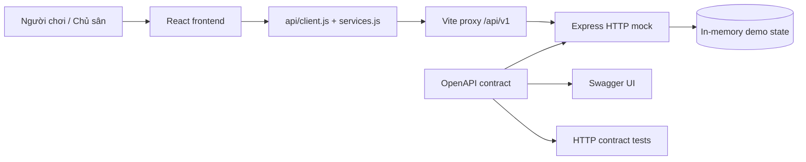
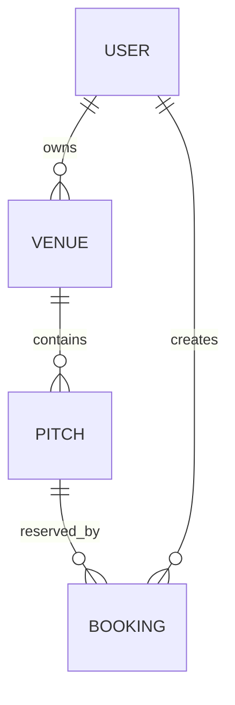
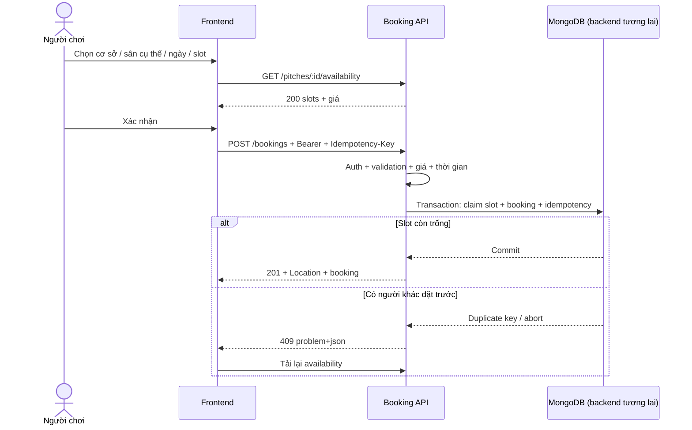

# Kiến trúc và chia việc

> **LEGACY — sơ đồ bên dưới thuộc phiên bản HTTP mock cũ.** Frontend hiện tại chạy độc lập bằng fixture trong tab; `npm run dev` chỉ chạy Vite. Sơ đồ và ranh giới triển khai mới ở [FRONTEND_HANDOFF.md](FRONTEND_HANDOFF.md).

## Kiến trúc hiện tại

Đây là skeleton frontend + một mock server, **chưa phải ba microservice đã triển khai**. Frontend không truy cập MongoDB. URL API được cấu hình bằng môi trường. Không tạo endpoint giả trong component hoặc Promise trả seed data; vì thế có thể phát triển/test backend từ cùng hợp đồng.

## Ranh giới dịch vụ đề xuất cho nhóm

| Module / service    | Sở hữu                                           | API công khai                                 |
| ------------------- | ------------------------------------------------ | --------------------------------------------- |
| Identity            | Users, sessions, credentials                     | `/sessions`, `/users/me`                      |
| Catalog             | Venues, pitches, chủ cơ sở, thông tin/giá cơ bản | `/venues`, `/venues/{id}/pitches`, `/pitches` |
| Booking & Inventory | Bookings, cancellations, slotClaims, idempotency | `/bookings`, `/pitches/{id}/availability`     |
| API gateway         | Routing, correlation, CORS, rate-limit tổng      | Prefix `/api/v1`                              |

Với quy mô đồ án, triển khai backend **modular monolith** là một bước dễ kiểm chứng: mỗi module có router/controller/service/repository riêng, cùng MongoDB replica set, giữ transaction đặt/xóa sân trong cùng database. Ranh giới SOA thể hiện qua hợp đồng và quyền sở hữu dữ liệu, không chỉ số process.

Nếu đề yêu cầu deploy các service tách process, cần chốt thêm cơ chế giao tiếp nội bộ, thông báo thay đổi giá, ngừng nhận booking, idempotency xuyên dịch vụ và consistency. Không chia DB rồi giả định MongoDB transaction xử lý được giao dịch giữa các service độc lập. Những phần này là thiết kế tiếp theo, chưa thực thi trong mock.

## Quan hệ dữ liệu và màn hình

Chủ sân sở hữu **cơ sở**; sân con tham chiếu `venueId` và kế thừa quyền từ cơ sở. `type` là thuộc tính của sân, không phải định danh tài nguyên có thể đặt. Không có quan hệ sân 11 chứa sân 5: mỗi pitch là một sân riêng biệt.

Luồng frontend: Explore (`/`) liệt kê cơ sở → VenueDetail (`/co-so/:venueId`) liệt kê sân cụ thể → PitchDetail (`/san/:pitchId`) chọn giờ → Bookings (`/lich-dat`). Chủ sân chọn cơ sở trước khi quản lý các sân bên trong. Booking giữ snapshot tên cơ sở, tên/loại sân, địa chỉ và giá để lịch sử không đổi sau khi catalog được sửa.

## Trình tự đặt sân

## Trách nhiệm frontend

- `pages/`: compose luồng giao diện, quản lý form và filter.
- `components/`: modal accessible, controls, error, empty, loading và layout dùng chung.
- `api/services.js`: hàm theo tài nguyên, payload công khai ổn định.
- `api/client.js`: base URL, headers, timeout, abort, JSON/error parsing, session-expired signal.
- `useResource`: hủy request cũ khi chuyển trang/filter; không để response cũ ghi đè dữ liệu mới.
- `AuthContext`: access token trong memory, trạng thái user, modal login/logout.

Không đưa chi tiết DB vào component. Không tính giá quyết định ở client. Giá trong form lấy từ availability, `total` cuối cùng lấy từ booking response. Tham số tìm kiếm nằm trên URL để chia sẻ/quay lại bằng Back/Forward.

## Chia việc gợi ý

| Thành viên        | Đầu ra cần bàn giao                                                     |
| ----------------- | ----------------------------------------------------------------------- |
| Frontend (bạn)    | Màn hình, responsive, client API, trạng thái lỗi, luồng đặt/hủy         |
| Backend Identity  | Login/logout thật, password hash, role/ownership middleware             |
| Backend Catalog   | Venue/pitch CRUD, quan hệ và quyền sở hữu, filter/sort/pagination, ETag |
| Backend Booking   | Availability, chống trùng slot, transaction, idempotency, cancellation  |
| Tích hợp/kiểm thử | CI, contract validation, test BOLA/concurrency, demo kịch bản           |

Một thành viên có thể phụ trách nhiều module. Khi đổi contract: thống nhất schema → cập nhật OpenAPI → test/mock → services/frontend. Không tự ý đổi response khi frontend đã tích hợp.
