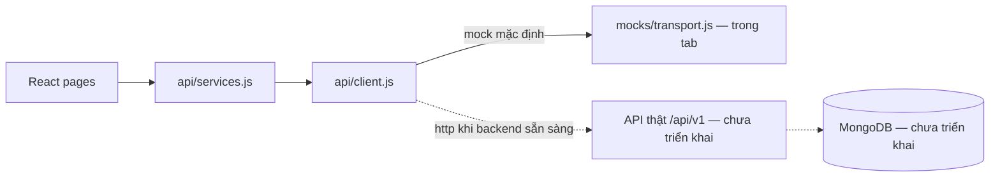
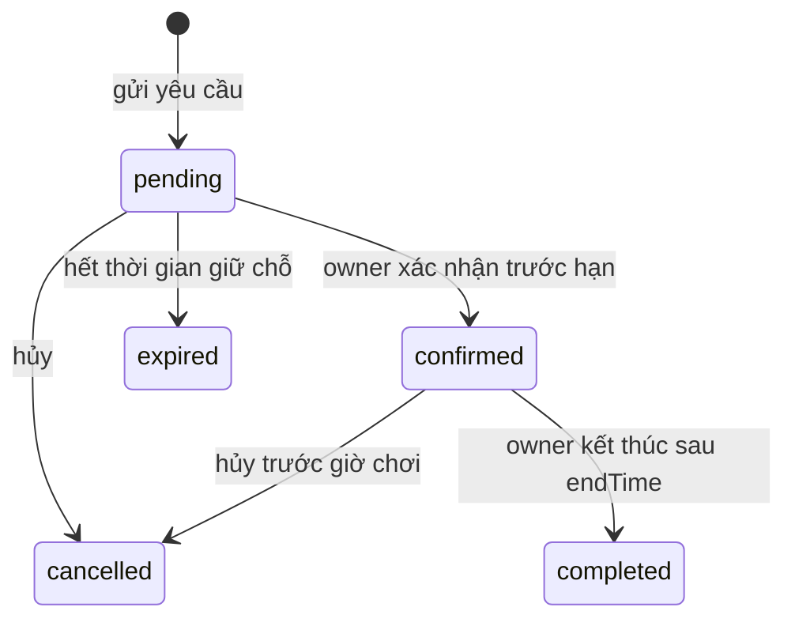

# Bàn giao frontend — venues / courts / bookings

Bản cập nhật 09/11/2026. Phạm vi: sửa frontend theo thiết kế nhóm; backend làm sau. Contract nguồn: `packages/contracts/frontend-openapi.js`; bản máy đọc được: `frontend-openapi.yaml` và `.json`. Chạy `npm run contract:export` sau khi sửa nguồn, rồi `npm run contract:check`.

## Ranh giới triển khai

Frontend không chứa kết nối MongoDB, password hash, secret thanh toán hay HTTP server mới. Adapter mock trả `Response` để sử dụng cùng bộ xử lý JSON/lỗi. Không thể dùng Postman gọi adapter trong tab. `POST /payments/callback` chỉ là vị trí dành sẵn cho backend, không do frontend gọi hoặc mô phỏng như một HTTP endpoint.

## Mô hình và DTO

API JSON dùng **camelCase**, kể cả khi nhóm dùng snake_case trong DB. `_id` của MongoDB được backend chuyển thành `id` chuỗi; frontend không giả định ObjectId, UUID hoặc ID mẫu. Không trả `password_hash`/`passwordHash` cho client.

| Entity    | Trường chính frontend nhận                                                           | Bổ sung so với phác thảo ban đầu                                                                              |
| --------- | ------------------------------------------------------------------------------------ | ------------------------------------------------------------------------------------------------------------- |
| User      | id, email, fullName, phone, role                                                     | role: CUSTOMER / OWNER / ADMIN; signup không nhận role                                                        |
| SportType | id, name                                                                             | Môn thể thao; số người không phải môn                                                                         |
| Venue     | id, ownerId, name, address, district, city, description, openTime, closeTime, status | timezone, amenities, imageKey, version; courtCount, courtTypes, minPrice, rating, reviewCount do API tổng hợp |
| Court     | id, venueId, sportTypeId, sportName, name, status                                    | teamSize (5/7/11/null), basePricePerHour, description, imageKey, version                                      |
| Booking   | id, userId, courtId, startTime, endTime, totalPrice, status, expiresAt               | code, venueId và snapshot tên sân/cơ sở/liên hệ, note, currency, paymentStatus; detail có review hoặc null    |
| Payment   | id, bookingId, amount, method, transactionRef, paidAt                                | status, currency, checkoutUrl (URL hoặc null), createdAt                                                      |
| Review    | id, venueId, userId, bookingId, rating, comment, createdAt                           | fullName để hiển thị, updatedAt                                                                               |

Booking lưu snapshot hiển thị để sửa/xóa danh mục không làm mất lịch sử. Review phải gắn đúng user, venue, booking. `imageKey` hiện chọn từ 3 ảnh minh họa local; upload ảnh để sau.

Hà Đông là một venue; Sân số 1 và Sân số 2 đều là bóng đá 5 người nhưng có `courtId` khác nhau. Không tạo booking chỉ theo venue hoặc teamSize. Tên sân chỉ cần duy nhất sau chuẩn hóa trong cùng venue.

## Endpoint và quyền

Tất cả đường dẫn dưới prefix `/api/v1`. Chi tiết input/response/header trong OpenAPI mới.

| Nhóm    | Endpoint                                                  | Quyền / cách dùng trên UI                                   |
| ------- | --------------------------------------------------------- | ----------------------------------------------------------- |
| Auth    | POST /auth/register, /auth/login                          | Public; register tạo CUSTOMER, sau đó UI đăng nhập          |
| Auth    | POST /auth/refresh, /auth/logout                          | Refresh cookie / phiên hiện tại; logout là endpoint bổ sung |
| User    | GET, PUT /users/me                                        | Đọc/sửa fullName và phone của mình                          |
| Sport   | GET /sport-types                                          | Public; UI đọc ID từ API                                    |
| Sport   | POST /sport-types; PUT, DELETE /sport-types/{id}          | ADMIN; môn đang có court không được xóa                     |
| Venue   | GET /venues; GET /venues/{id}                             | Public, mặc định chỉ cơ sở hoạt động                        |
| Venue   | POST /venues; PUT, DELETE /venues/{id}; GET /owner/venues | OWNER; sửa/xóa chỉ cơ sở thuộc mình                         |
| Court   | GET /venues/{venueId}/courts; GET /courts/{id}            | Public; token owner được xem cả sân tạm ngừng của mình      |
| Court   | POST /venues/{venueId}/courts; PUT, DELETE /courts/{id}   | OWNER của venue cha; venueId bất biến khi sửa               |
| Court   | GET /courts/{id}/availability?date=YYYY-MM-DD             | Lịch 30 phút, không trả tên/điện thoại người đặt            |
| Court   | GET /courts/{id}/quote?start=&end=                        | Báo giá toàn khoảng giờ; không giữ chỗ                      |
| Booking | POST /bookings                                            | CUSTOMER, courtId/startTime/endTime/note; Idempotency-Key   |
| Booking | GET /bookings/{id}; GET /users/me/bookings                | Lịch của mình; detail cho phép owner quản lý venue đó       |
| Booking | GET /venues/{venueId}/bookings                            | OWNER của venue; lọc date, status, phân trang               |
| Booking | POST /bookings/{id}/cancel                                | Khách sở hữu lịch hoặc owner của venue                      |
| Booking | POST /bookings/{id}/confirm, /complete                    | OWNER của venue; điều kiện trạng thái và thời gian          |
| Payment | POST /bookings/{id}/payments                              | Khách sở hữu lịch đã confirmed, chưa trả; Idempotency-Key   |
| Payment | GET /bookings/{id}/payments; GET /payments/{id}           | Khách sở hữu hoặc owner quản lý venue                       |
| Payment | POST /payments/callback                                   | Backend ↔ nhà cung cấp; chưa chốt payload/chữ ký           |
| Review  | GET /venues/{venueId}/reviews                             | Public, phân trang                                          |
| Review  | POST /venues/{venueId}/reviews                            | Khách có booking completed tại venue; 1 review/booking      |
| Review  | PUT, DELETE /reviews/{id}                                 | Chỉ tác giả                                                 |

Ẩn nút theo role trong React chỉ giúp giao diện. Backend phải kiểm tra role **và quyền trên từng tài nguyên**; ADMIN không mặc nhiên đọc booking/payment riêng tư trong contract này. API trả 404 cho booking/payment không thuộc phạm vi truy cập.

## Quy ước HTTP

- Success: `{ data: ... }`; collection phân trang: `{ data: [], meta: { page, limit, total, totalPages }, links: { self, prev, next } }`. `sport-types` và danh sách payment không phân trang ở bản này.
- Trang bắt đầu từ 1, limit tối đa 50. UI dùng limit 6/8 tùy màn. Filter và sort được lưu trong query string tại các trang public/lịch của tôi.
- `GET /venues`: keyword, city, district, sportTypeId, teamSize, maxPrice, sort, page, limit. Các filter theo sân phải cùng khớp **một court hoạt động**, tránh lấy giá sân 5 để báo cơ sở có sân 11 rẻ. Summary/minPrice vẫn tính trên toàn bộ court hoạt động trong venue.
- Ngày chọn ở trang tìm kiếm được chuyển sang màn đặt sân, **không phải bộ lọc còn chỗ của GET /venues**.
- `POST` tạo: 201 và Location; `GET`/`PUT`/action: 200; `DELETE`/logout: 204 không body.
- Lỗi `application/problem+json`: type, title, status, detail, instance, code; có thể thêm requestId/errors. Client hiển thị detail; logic không dựa vào câu tiếng Việt.
- 400 query sai, 401 chưa đăng nhập, 403 sai quyền, 404 không có/không được xem, 409 trùng lịch/trạng thái xung đột, 422 body sai, 412 version cũ, 428 thiếu If-Match.
- GET/POST/PUT venue/court trả ETag. PUT/DELETE gửi `If-Match: "<version>"`; thay đổi court cập nhật version của venue để phát hiện dữ liệu tổng hợp cũ. Xóa venue có court trả 409, không cascade.
- POST booking/payment yêu cầu `Idempotency-Key` cho một lần thử logic. Retry cùng body/key trả cùng kết quả; cùng key khác body trả 409. Client giữ key khi thử lại lỗi mạng. Backend cần lưu ít nhất 24h, scope theo user + operation.
- API lấy user/owner/contact/amount/price từ phiên và dữ liệu tin cậy, không nhận các giá trị này từ body đặt sân/thanh toán.
- Access token ở bộ nhớ; request có Bearer và `credentials: include`. 401 trên request đã đăng nhập sẽ refresh rồi retry một lần. Trang tải mới cần đăng nhập lại trong bản frontend này; chưa có bootstrap phiên tự động.
- Backend cần refresh cookie HttpOnly/Secure/SameSite phù hợp deployment, rotation/revocation; CORS origin cụ thể + credentials và expose ETag/Location/Request-ID khi khác origin. Đây là công việc phía backend.

## Chính sách đang dùng để demo

Các chính sách dưới đây là lựa chọn triển khai frontend, cần nhóm chốt khi viết backend.

- Giờ hiển thị Asia/Ho_Chi_Minh; API timestamp có timezone/offset, DB nên lưu thời điểm UTC. Ngày availability là ngày địa phương. Chưa hỗ trợ phiên chơi qua nửa đêm hoặc giờ mở cửa qua ngày.
- Khoảng đặt 30–180 phút, bước 30 phút, từ hôm nay đến +30 ngày; nằm trong giờ mở cửa. Giao nhau theo `[startTime,endTime)`, nên 18–19 và 19–20 không trùng.
- Mock cộng 100.000 VND/giờ trong 17–22h, tính từng đoạn 30 phút; giá cuối là số nguyên VND. Quy tắc giá thực tế/rate schedule để backend chốt. Frontend lấy quote, không tự chốt giá.
- `pending` giữ chỗ đến `min(now + 30 phút, startTime)`; `confirmed` giữ lịch đến khi hủy/hoàn thành. Hết hạn giải phóng slot, không xóa lịch.
- Owner xác nhận trước giờ bắt đầu; hoàn thành sau giờ kết thúc. Khách hủy trước ít nhất 2h, owner hủy trước giờ bắt đầu. Hủy cần reason; action lặp lại trên trạng thái đã đạt trả kết quả hiện có.
- Booking status khác payment status. Thanh toán chỉ khởi tạo khi booking confirmed; payment pending không có nghĩa là paid. Một booking có nhiều lần thử, tối đa một pending. Completed cũng không tự suy ra đã trả tiền.
- Mock có nút giả lập succeeded/failed, gọi helper nội bộ `settlePayment`. Chế độ HTTP không có các nút này. Kết quả thật phải đến từ provider hoặc quy trình xác nhận thu tiền đáng tin cậy.
- Hủy lịch đã paid chuyển `refund_pending`, giữ nguyên lịch sử payment. Chưa có endpoint/UI hoàn tiền thật hoặc xác nhận thu tiền mặt; backend cần bổ sung và chốt contract khi làm phần này.
- Review chỉ từ completed booking của chính khách tại venue, 1/booking; tác giả sửa/xóa; rating venue tính lại. Không cho gửi userId/fullName tùy ý.

## Giới hạn fixture và phần backend còn lại

Mock chạy trong một tab, reset khi reload, không chia sẻ phiên giữa tab. Refresh chỉ giả lập bằng biến trong bộ nhớ; không có cookie bảo mật hay password hash thật. Expiry kiểm tra khi có request (detail pending tự refetch), không có background worker. Idempotency không tồn tại qua reload, không mô phỏng đầy đủ retention 24h. Validation/phân quyền trong mock phục vụ scenario, không chứng minh bảo mật production.

Backend cần làm MongoDB collections/indexes/transactions, unique email, unique review booking, chống đua đặt lịch bằng cơ chế atomic cho tất cả slot, worker hết hạn, password hashing, session store, rate limits, request validation, audit/logging, provider callback có chữ ký và xử lý callback trùng/đến muộn, hoàn tiền. Không dùng TTL để xóa booking lịch sử. Với phân đoạn 30 phút, có thể triển khai claim unique `(courtId, slotStart)` trong transaction; unique index trên `(courtId,startTime,endTime)` đơn thuần không ngăn mọi khoảng giao nhau.

Chưa chạy MongoDB hoặc API production, chưa xác minh nhiều process/client đặt đồng thời. Tests adapter không thay thế các integration tests đó.

## Thay mock bằng backend

1. Implement OpenAPI mới dưới `/api/v1`, giữ nguyên casing/envelope/DTO/header/quyền.
2. Tạo `apps/web/.env.local` với `VITE_API_MODE=http`, `VITE_API_BASE_URL=/api/v1`, `API_PROXY_TARGET=http://127.0.0.1:8080`; restart Vite. Production cần reverse proxy `/api` hoặc URL backend/CORS thích hợp.
3. Test đăng nhập/refresh và profile trước, rồi catalog/court/quote, booking actions, payment/review. UI có retry/loading/error; không tự fallback mock.
4. Khi đổi quy tắc, sửa contract nguồn và các scenario test cùng frontend. Không chỉ đổi fixture để che lỗi backend.

`apps/mock-api` cũ dùng `pitches`, `startAt`, cursor, vai trò cũ. Nó được giữ nguyên để tham khảo và chạy hồi quy; không tương thích frontend mới. `docs/API_DESIGN.md`, `ARCHITECTURE.md`, `MONGODB.md`, `BACKEND_HANDOFF.md`, `requests.http`, `VERIFICATION.md`, `database/indexes.mongosh.js` là tài liệu/schema legacy; không áp dụng nguyên trạng cho API mới.
